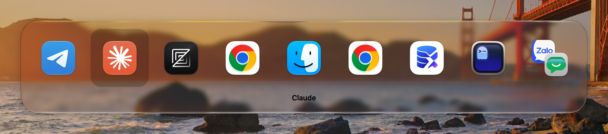
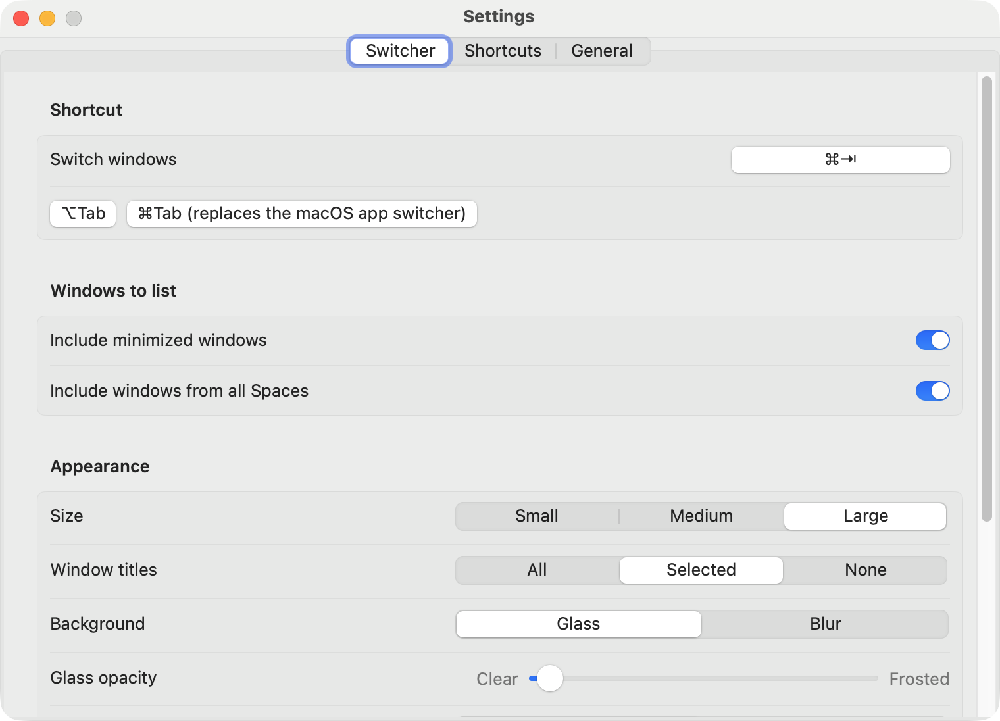
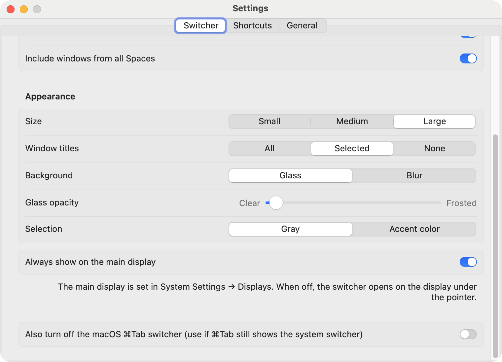
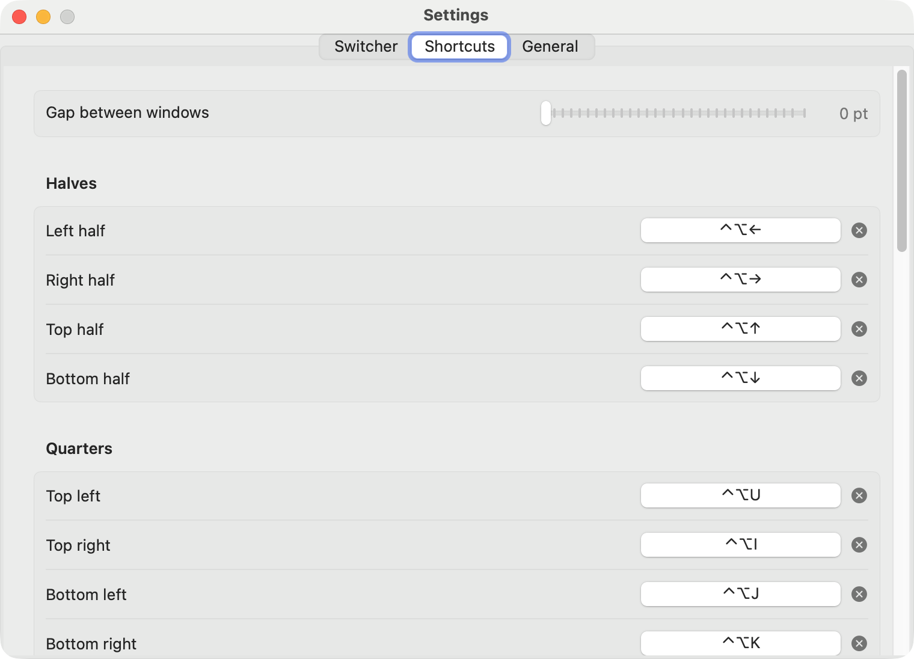
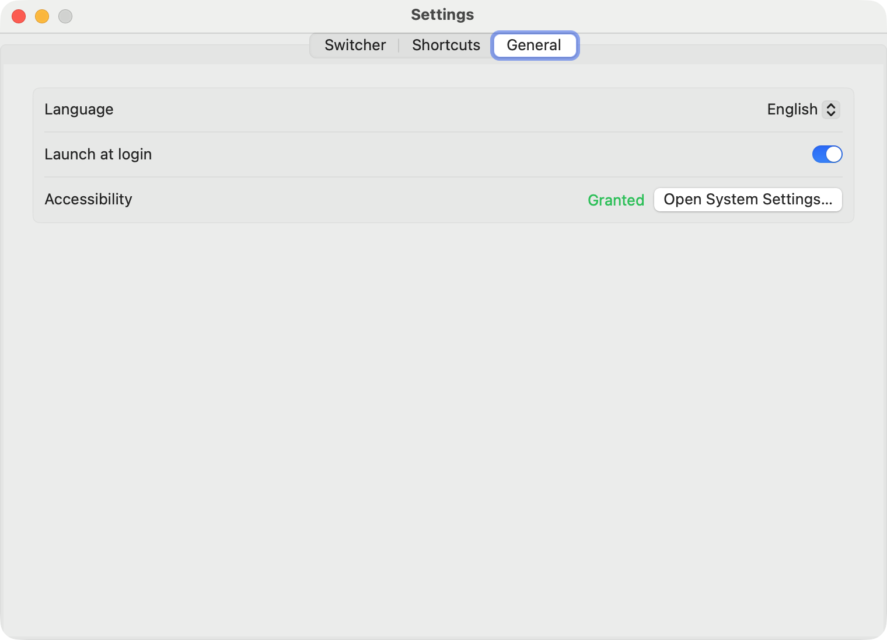

<p align="center">
  
</p>

<h1 align="center">WindowFlow</h1>

<p align="center">A lightweight macOS menu bar app for Windows-style Alt-Tab and keyboard window management.</p>

## Features

- **Alt-Tab for windows**: hold ⌥ Option and press Tab to pick any window, not just any app. The list covers every
  Space and minimized windows, shows the app icon and window title, and is ordered by recent use. A quick tap
  toggles between the last two windows without showing the list.
- **Switcher appearance**: small, medium or large tiles, window titles under every tile, only for the
  selected window (like ⌘Tab) or none, a Liquid Glass (macOS 26+)
  background with adjustable opacity or a blurred one, and a gray or accent-colored selection.
- **Pick the display**: the switcher opens on the display under the pointer, or always on the main display if you
  prefer.
- **Replace ⌘Tab**: one click makes ⌘Tab open WindowFlow instead of the macOS app switcher, or record any other
  shortcut.
- **Window groups**: windows that together fill a display, for example two halves or four quarters, show up as one
  tile such as "Safari + Notes". Picking it brings the whole group forward. While you are inside a group its windows
  are listed separately, so you can still switch between them.
- **Keyboard window management** with Rectangle-style defaults: halves, quarters, thirds, two-thirds, maximize,
  almost maximize, maximize height, larger, smaller, center, restore, and moving a window to the next or previous
  display. Repeating a half shortcut cycles the width through 1/2, 2/3 and 1/3.
- **Maximize / restore size**: one shortcut that works like double-clicking a title bar: press it to fill the screen,
  press it again to put the window back where it was.
- **Gap between windows**: 0–30 pt around tiled windows and the screen edges.
- **Every shortcut is re-bindable** or can be cleared from Settings.
- **English and Vietnamese UI**: chosen on first launch, switchable any time from the menu or Settings.
- **Settings window** with Switcher, Shortcuts and General tabs.
- **Launch at login** from the menu or Settings.
- No window thumbnails, so no Screen Recording permission, and close to zero CPU when idle (about 11 MB of memory).

## Screenshots



| Switcher | Appearance |
| --- | --- |
|  |  |
| **Shortcuts** | **General** |
|  |  |

## Requirements

macOS 14 Sonoma or later, on Apple silicon or Intel.

## Install

1. **Download** `WindowFlow-<version>.dmg` from the
   [latest release](https://github.com/quocmanhit/window-flow/releases/latest).
2. **Open the disk image** and drag **WindowFlow** onto the **Applications** shortcut next to it.
3. **Open WindowFlow** from Applications. The app is not notarized, so the first time macOS says it can't be opened.
   Go to **System Settings → Privacy & Security**, scroll down and click **Open Anyway**, then confirm. Alternatively,
   clear the quarantine flag in Terminal and open it normally:

   ```bash
   xattr -dr com.apple.quarantine /Applications/WindowFlow.app
   ```

4. **Pick a language.** The first launch asks for English or Tiếng Việt. You can change it later under
   **Language / Ngôn ngữ** in the menu.
5. **Grant Accessibility access.** macOS asks for it right after; otherwise open **System Settings → Privacy &
   Security → Accessibility** and turn **WindowFlow** on. WindowFlow starts working as soon as access is granted, with
   no relaunch needed. Until then the menu shows *Grant Accessibility permission…*.
6. **Set it up** from the window icon in the menu bar: open **Settings…** (⌘,) to choose the switcher shortcut and
   change window shortcuts, and turn on **Launch at login** if you want it to start with macOS.

### Update

Quit WindowFlow from its menu, then drag the new version into Applications and replace the old one. Settings are kept.

### Uninstall

1. Quit WindowFlow from its menu and move `/Applications/WindowFlow.app` to the Trash.
2. Remove it from **System Settings → Privacy & Security → Accessibility**.
3. Optionally delete its settings: `defaults delete com.quocmanh.windowflow`

## Using the switcher

| Key | Action |
| --- | --- |
| ⌥Tab (hold ⌥) | Open the list and move to the next window |
| ⇧ while pressing Tab, or ← / → | Move back or forward |
| Release ⌥ or press Return | Switch to the selected window |
| Esc | Close the list without switching |

Hovering a tile selects it and clicking switches to it. Picking a window on another Space moves to that Space.

## Default window shortcuts

| Action | Shortcut |
| --- | --- |
| Left / Right / Top / Bottom half | ⌃⌥← / ⌃⌥→ / ⌃⌥↑ / ⌃⌥↓ |
| Top-left / Top-right / Bottom-left / Bottom-right quarter | ⌃⌥U / ⌃⌥I / ⌃⌥J / ⌃⌥K |
| First / Center / Last third | ⌃⌥D / ⌃⌥F / ⌃⌥G |
| First / Last two-thirds | ⌃⌥E / ⌃⌥T |
| Maximize / Almost maximize / Maximize height | ⌃⌥↩ / unassigned / ⌃⌥⇧↑ |
| Maximize / restore size (toggle) | ⌃⌥⌘↩ |
| Larger / Smaller | ⌃⌥= / ⌃⌥- |
| Center / Restore | ⌃⌥C / ⌃⌥⌫ |
| Next / Previous display | ⌃⌥⌘→ / ⌃⌥⌘← |

A shortcut needs ⌃, ⌥ or ⌘, except F1–F20, which can be used alone. Restore returns a window to its frame before the
first WindowFlow action. Moving to another display keeps the window's relative position and size.

## Known limitations

- Don't run WindowFlow together with Rectangle, AltTab or another app that uses the same shortcuts: whichever sees a
  key first takes it.
- WindowFlow has no drag-to-snap; dragging a window to a screen edge uses the tiling built into macOS 15 and later.
- Full-screen windows can't be moved or resized, and some apps refuse to resize; WindowFlow then only moves them.
- Listing windows on other Spaces and switching to a specific window rely on private macOS APIs. If a future macOS
  removes them, WindowFlow falls back to windows on the current Space and switching by app.
- A window set to appear on all Desktops (Dock icon → Options → Assign To → All Desktops) is listed once but can't be
  part of a window group.

## Build from source

Requires Xcode Command Line Tools (Swift 5.10+).

```bash
git clone https://github.com/quocmanhit/window-flow.git
cd window-flow
make run
```

`make run` builds the app, installs it to `~/Applications` and launches it. It is signed with the `Apple Development`
identity so the Accessibility permission survives rebuilds; without one, use `make run SIGN_ID=-` and grant the
permission again after each build.

- `make dist` packages a universal app into `build/WindowFlow-<version>.dmg`, using the version in
  `Resources/Info.plist`.
- `swift test` runs the unit tests for the layout, shortcut, ordering and grouping logic.

See [docs/how-it-works.md](docs/how-it-works.md) for how the switcher and window management are implemented.

## License

[MIT](LICENSE) © 2026 Quốc Mạnh
